<p align="center">
  
</p>

<p align="center">
  <a href="https://oaknet.io"></a>
  
  
</p>

### `> STATUS`

```diff
+ NAME ......... Andrea Guglielmo
+ CLASS ........ Founder & Technical Director
+ FACTION ...... OakNet S.r.l. — fiber ISP / MSP
+ SECTOR ....... Lombardy wasteland, Italy
+ SPECIALTY .... Networks · Cloud · Cybersecurity · AI agents
- RADS ......... 0 (everything behind a firewall)
```

### `> ATTRIBUTES`

```diff
+ NETWORKING ..... [██████████] 10
+ SECURITY ....... [█████████░]  9
+ INFRASTRUCTURE . [█████████░]  9
+ AUTOMATION ..... [████████░░]  8
+ CODE ........... [███████░░░]  7
+ COMPLIANCE ..... [███████░░░]  7
- SLEEP .......... [██░░░░░░░░]  2
```

### `> PERKS`

```diff
+ [RANK 3] PACKET WHISPERER ... BGP, VRRP, policy routing, XGS-PON bring-up
+ [RANK 3] BUNKER BUILDER ..... designing an underground, solar-powered datacenter
+ [RANK 2] BLUE TEAM .......... SIEM/XDR, hardening, NIS2 & GDPR
+ [RANK 2] ROBOT WRANGLER ..... autonomous agents on Claude Code & MCP
```

### `> INVENTORY`

<p>
  
  
  
  
  
  
  
  
  
  <br>
  
  
  
  
  
  
</p>

### `> QUEST LOG`

```diff
+ [ACTIVE]  OAKNET GRID ........ fiber connectivity, managed networks & cloud for Italian businesses
+ [ACTIVE]  DEEPSEC AI ......... SIEM + XDR platform built for SMEs
+ [ACTIVE]  VICE ............... autonomous agent that handles mail, chat & ERP on my behalf
+ [ACTIVE]  THE BUNKER ......... green, underground datacenter — phase 1: 9 racks / 100 kW
- [LOCKED]  SOURCE CODE ........ most repos are private — ask for clearance
```

### `> TERMINAL DIAGNOSTICS`

<p align="center">
  
  
</p>

<p align="center">
  
</p>

### `> HOLOTAPES`

<p>
  <a href="https://oaknet.io"></a>
  <!-- <a href="https://www.linkedin.com/in/TODO"></a> -->
</p>

```diff
! > LOGOFF
! Stay safe out there, wanderer. Keep your firmware patched.
```
